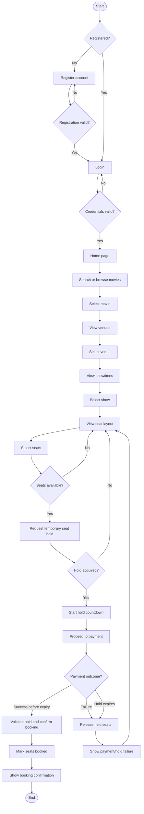

# 4. Customer Use Case – Movie Booking

**Status:** Initial flow draft. Actor-level UML use-case diagram and admin use cases will be expanded during the design review.

## Actors

- **Customer:** Registers or logs in, discovers movies, chooses a venue and show, selects seats, pays, and manages bookings/profile.
- **Admin:** Manages movies, venues, screens, seat layouts, shows, and booking reports.
- **Payment gateway:** Processes a payment request and reports its outcome.

## Customer booking journey

## Key alternate flows

1. Invalid registration: show validation errors and allow correction.
2. Invalid login: show a safe authentication error and allow retry.
3. Seat becomes unavailable before hold acquisition: refresh seat availability and ask the customer to choose again.
4. Payment fails: release the hold and show the failure result.
5. Hold expires during checkout: do not confirm the booking; release the seats.
6. Payment result arrives late: reconcile the payment result safely; never confirm a seat that has already been reallocated.

## Important clarification

The seat hold is acquired by the backend as one atomic operation for the selected seats. A frontend countdown is only a display; the backend's hold expiry is authoritative.
