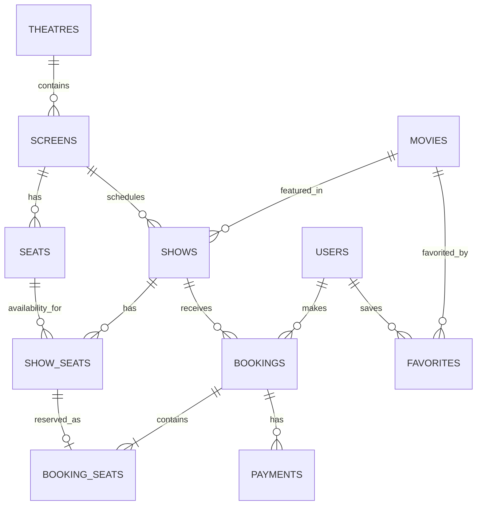

# ER Diagram and Database Design

**Status:** Initial ER design finalized for the first implementation.

This document records the initial SeatLock relational ER diagram. It is the design baseline for creating the Spring Boot JPA entities. We may make reviewed changes as implementation details become clear.

## Entity relationship diagram

## Tables and responsibilities

| Table | Responsibility |
|---|---|
| `users` | Customer and administrator accounts |
| `movies` | Movie details |
| `theatres` | Physical cinema locations |
| `screens` | Auditoriums within a theatre |
| `seats` | Physical seats within a screen |
| `shows` | Scheduled screenings of movies on screens |
| `show_seats` | Availability and price of each physical seat for a particular show |
| `bookings` | Overall customer booking |
| `booking_seats` | Individual show seats included in a booking |
| `payments` | Payment attempts and their outcomes |
| `favorites` | Movies saved by users |

## Key relationship rules

- One theatre contains multiple screens; each screen belongs to one theatre.
- One screen has multiple physical seats and can host multiple shows.
- One movie can appear in multiple shows; each show features one movie.
- Each show has availability records for its seats. A physical seat can therefore be available for one show and booked for another.
- A user can make multiple bookings. In the initial design, each booking is for one show.
- A booking contains one or more booking-seat records and can have multiple payment attempts.
- A user can favorite multiple movies, and a movie can be favorited by multiple users.

## Important booking design

The `show_seats` table is essential because seat availability belongs to a specific show, not to the physical seat itself. The pair `(show_id, seat_id)` must be unique.

Suggested initial seat statuses:

- `AVAILABLE`
- `HELD`
- `BOOKED`

The backend must acquire requested seats atomically so that a concurrent request cannot hold or book a seat already held by another customer. The database remains the final authority for confirmed bookings.

## Scope and implementation notes

- This is the initial core schema: 11 tables.
- A booking is limited to one show in the first version to keep checkout and payment handling straightforward.
- Payment retries are represented as multiple rows in `payments` for one booking.
- Foreign keys, unique constraints, indexes, exact column types, and entity mappings will be specified as we implement each entity.
- This design is a baseline, not a claim that all production concurrency and payment edge cases are solved by the ER diagram alone.
